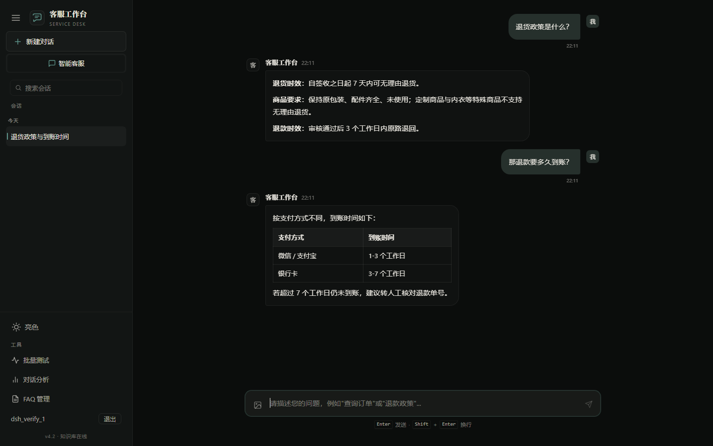
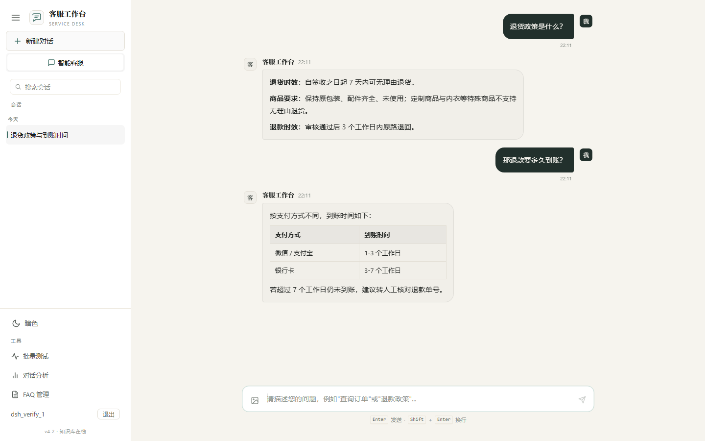
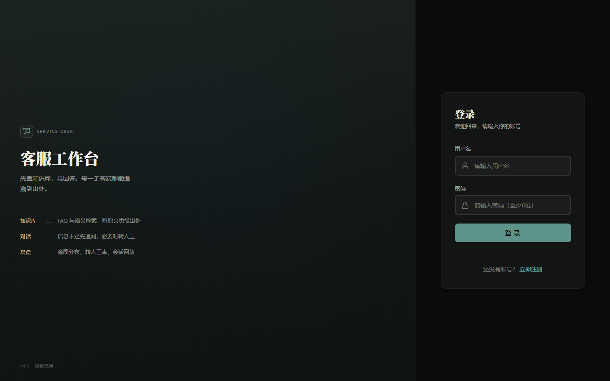
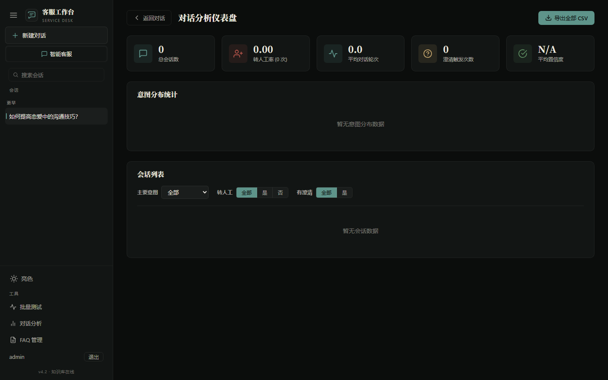
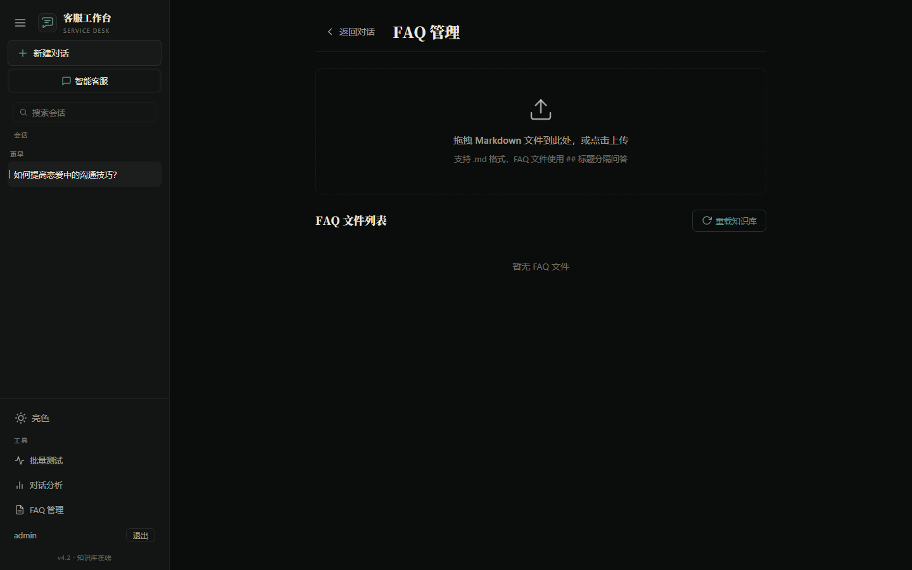

# 智能客服 Agent — 基于 RAG 知识库的多轮对话系统

基于 **Spring Boot 3.5 + Vue 3** 构建的智能客服系统，集成意图识别与槽位提取、两级知识库检索（FAQ + 混合检索）、多轮对话管理、主动澄清、拒识转人工等核心能力。

---

## 界面预览

| 对话（深色） | 对话（浅色） |
| --- | --- |
|  |  |

| 登录 | 对话分析 | FAQ 管理 |
| --- | --- | --- |
|  |  |  |

设计与改造说明见 [docs/UI-设计说明.md](docs/UI-设计说明.md)。

## 竞赛功能快速入口

### 批量评测

1. 登录系统后，点击左下角 **"批量测试"** 按钮
2. 上传隐藏测试集文件（支持 `.md` / `.docx` / `.pdf`，格式需与知识库一致）
3. 系统自动解析 QA 对并逐条检索知识库，对比预期 kbId 是否命中
4. 测试完成后可查看每道题的命中状态、相关度、耗时
5. 点击 **"下载结果 CSV"** 导出详细评测报告

### 结果下载

- **批量测试结果**：在批量测试结果面板中点击 "下载结果 CSV"
- **对话日志导出**：在 "对话分析" 页面，可导出全部或单个会话的 CSV 日志

### 首页功能

- 左侧边栏：对话历史、新建对话、批量测试入口、对话分析入口、FAQ 管理入口
- 对话区：SSE 流式对话、意图识别展示、来源标注、推荐问题、澄清追问、转人工
- 欢迎页：快捷问题入口

---

## 核心能力（赛题要求对照）

| 赛题要求 | 实现方式 |
|----------|----------|
| 意图识别与槽位提取 | `IntentClassifier` — 分类10种意图 + 提取订单号/产品名/问题类型等槽位 |
| 知识库检索问答 | 两级检索：Tier1 FAQ 精确匹配 + Tier2 混合检索（BM25 + PgVector RRF 融合），答案标注来源 |
| 多轮对话管理 | `DialogStateManager` — 上下文跟踪、指代消解、省略补全、话题切换检测 |
| 主动澄清 | 信息不足时主动反问（如要求提供订单号），支持槽位填充逐轮追问 |
| 拒识与转人工 | 超出知识库范围明确告知并建议转人工，连续超范围自动转接 |
| Web UI 交互测试 | Vue 3 SPA，SSE 流式对话，意图/澄清/转人工状态实时展示 |
| 对话日志导出与分析 | CSV 导出 + 仪表盘（意图分布、转人工率、平均轮次、置信度统计） |

---

## 项目架构

```
AI_Agent/
├── src/                                    # 后端 - Spring Boot 3.5 (Java 21)
│   └── main/java/com/qh/ai_agent/
│       ├── AiAgentApplication.java         # 启动入口
│       ├── Agent/                          # 自主智能体框架
│       │   ├── BaseAgent.java              # 基础智能体（状态管理、SSE 推送）
│       │   ├── ReActAgent.java             # ReAct 推理-行动模式
│       │   ├── ToolCallAgent.java          # 工具调用智能体
│       │   └── customer_service/           # ★ 客服 Agent
│       │       ├── CustomerServiceAgent.java  # 集成意图识别+槽位+澄清+消解+转人工
│       │       └── CustomerServiceTools.java  # 知识库搜索工具
│       ├── controller/
│       │   ├── CustomerServiceController.java  # ★ 客服对话 + 批量测试 API
│       │   ├── AnalyticsController.java       # ★ 对话分析 + CSV 导出 API
│       │   └── AuthController.java            # 认证 API
│       ├── intent/                         # ★ 意图识别与槽位提取
│       │   ├── IntentClassifier.java       # 意图分类器
│       │   ├── IntentConfig.java           # 意图/槽位配置
│       │   └── model/                      # IntentResult, SlotDefinition 等
│       ├── dialog/                         # ★ 多轮对话状态管理
│       │   ├── DialogStateManager.java     # 对话状态管理器
│       │   └── model/DialogState.java      # 状态模型
│       ├── knowledge/                      # ★ 两级知识库检索
│       │   ├── KnowledgeSearchService.java # 搜索编排：FAQ → 混合检索
│       │   ├── KnowledgeBaseLoader.java    # classpath FAQ 加载器
│       │   ├── CustomerServiceVectorStoreConfig.java  # PgVector 向量库
│       │   ├── parser/                     # KB 文件解析器 (.md/.docx/.pdf)
│       │   └── retriever/                  # 混合检索器 (BM25 + PgVector RRF)
│       ├── service/
│       │   ├── AnalyticsService.java       # ★ 对话分析服务
│       │   ├── ExportService.java          # ★ CSV 导出服务
│       │   ├── ConversationService.java    # 对话持久化
│       │   └── UserService.java            # 用户管理
│       ├── dto/BatchTestResult.java        # ★ 批量测试结果 DTO
│       ├── entity/                         # 数据库实体
│       └── mapper/                         # MyBatis-Plus Mapper
├── AI_Agent_Fronted/                       # 前端 - Vue 3 + Vite
│   └── src/
│       ├── components/
│       │   ├── ChatView.vue                # ★ 对话主界面
│       │   ├── ChatMessage.vue             # 消息气泡（含意图/来源/推荐问题）
│       │   ├── ChatInput.vue               # 输入框（支持图片上传）
│       │   ├── Sidebar.vue                 # 侧边栏（含批量测试按钮）
│       │   ├── BatchTestPanel.vue          # ★ 批量测试弹窗（含结果下载）
│       │   ├── AnalyticsView.vue           # ★ 对话分析仪表盘（含 CSV 导出）
│       │   ├── AdminFAQView.vue            # FAQ 管理界面
│       │   ├── WelcomeScreen.vue           # 欢迎页（快捷问题）
│       │   └── LoginView.vue               # 登录页
│       ├── composables/
│       │   ├── useChat.js                  # 对话逻辑（SSE 流式）
│       │   └── useConversations.js         # 会话管理
│       ├── api/                            # API 封装
│       └── router/index.js                 # 路由配置
├── data/data/knowledge_base/               # ★ 比赛知识库文件
└── pom.xml                                 # Maven 构建配置
```

---

## 技术栈

### 后端
| 技术 | 版本 | 用途 |
|------|------|------|
| Spring Boot | 3.5.10 | 应用框架 |
| Java | 21 | 编程语言 |
| Spring AI | 1.1.2 | AI 模型集成 |
| Spring AI Alibaba | 1.1.2.0 | DashScope 集成 |
| PGVector | - | PostgreSQL 向量检索 |
| MyBatis-Plus | 3.5.9 | ORM |
| Knife4j | 4.4.0 | API 文档 |
| Lucene | - | BM25 全文检索 |
| JWT | - | 用户认证 |

### 前端
| 技术 | 版本 | 用途 |
|------|------|------|
| Vue | 3.4 | UI 框架 |
| Vue Router | 4.3 | 路由 |
| Vite | 5.4 | 构建工具 |
| Axios | 1.7 | HTTP 客户端 |
| Marked | 12.0 | Markdown 渲染 |

---

## 快速开始

### 环境要求

- **JDK 21+**
- **Node.js 18+**
- **PostgreSQL 14+**（需安装 PGVector 扩展）
- **Maven 3.8+**
- **DashScope API Key**（测试用）或公司 AI 网关访问权限

### 0. 克隆后的第一步：准备本地配置（必做）

本仓库**不包含** `src/main/resources/application-local.yml`。它保存的是本机私有配置（数据库口令、API Key），
已在 `.gitignore` 中，不会被提交；因此刚 clone 下来时它并不存在，**不准备这个文件项目无法启动**。

```bash
# Linux / macOS / Git Bash
cp src/main/resources/application-local.yml.example src/main/resources/application-local.yml

# Windows PowerShell
Copy-Item src/main/resources/application-local.yml.example src/main/resources/application-local.yml
```

然后编辑 `application-local.yml`，至少填好这两组值：

| 配置项 | 说明 |
| --- | --- |
| `spring.datasource.url` / `username` / `password` | 本机 PostgreSQL 连接信息 |
| `spring.ai.openai.api-key`、`spring.ai.dashscope.api-key` | DashScope API Key（**两处都要填**） |

> 填好真实值的 `application-local.yml` 只保留在本地，不要提交（`.gitignore` 已忽略它）。
> OSS / MNS / SMQ 等云端配置可以留空，相关功能会自动走降级逻辑（见「缺少配置时的行为」）。

### 1. 数据库准备

```sql
CREATE DATABASE "Love_Agent";
CREATE EXTENSION IF NOT EXISTS vector;
```

### 2. API 配置

编辑上一步复制出来的 `src/main/resources/application-local.yml`：

**测试模式（DashScope 兼容端点，无需 VPN）**：
```yaml
spring:
  ai:
    openai:
      api-key: sk-xxxxxxxxxxxxxxxxxxxxxxxxxxxxxxxx
      base-url: https://dashscope.aliyuncs.com/compatible-mode
    dashscope:
      api-key: sk-xxxxxxxxxxxxxxxxxxxxxxxxxxxxxxxx
```

**公司网关模式（需要 VPN）**：
```yaml
spring:
  ai:
    openai:
      api-key: PUT_YOUR_DASHSCOPE_API_KEY_HERE
      base-url: https://aigw.asiainfo.com/v1
```

模型切换：编辑 `src/main/resources/application-dev.yml` 中的 `spring.ai.openai.chat.options.model`：
- 测试用：`qwen-plus`
- 公司网关：`aliyun/glm-5`

### 3. 启动后端

```bash
cd AI_Agent
mvn spring-boot:run -Dmaven.test.skip=true
```

后端运行在 `http://localhost:8123/api`，接口文档 `http://localhost:8123/api/doc.html`。

### 4. 启动前端

```bash
cd AI_Agent_Fronted
npm install
npm run dev
```

前端运行在 `http://localhost:5173`，自动代理 API 到后端。

### 5. 知识库初始化

启动时自动从 `data/data/knowledge_base/` 加载知识库并构建向量索引（首次大约 1-2 分钟），重启后复用已有索引。

---

## 知识库检索架构

```
用户查询
  ├── Tier 1: FAQ 精确匹配
  │   ├── 精确/包含/关键词/编辑距离/字符Jaccard 多维相似度计算
  │   └── 得分 ≥ 0.6 → 直接返回 + 推荐同类别 FAQ
  └── Tier 2: 混合检索
      ├── BM25 稀疏检索 (topK=10)
      ├── PgVector 稠密检索 (topK=10)
      └── RRF 融合 (k=10) → 去重排序 → 返回 topK
```

---

## API 接口（核心）

| 方法 | 路径 | 说明 |
|------|------|------|
| GET | `/api/customer-service/chat` | SSE 流式客服对话 |
| POST | `/api/customer-service/batch-test` | ★ 批量 RAG 测试（上传文件） |
| GET | `/api/customer-service/session/{id}/state` | 获取对话状态 |
| GET | `/api/analytics/overview` | 分析总览 |
| GET | `/api/analytics/intent-distribution` | 意图分布 |
| GET | `/api/analytics/sessions` | 会话列表（分页/排序/筛选） |
| GET | `/api/analytics/sessions/{id}` | 会话详情回放 |
| GET | `/api/analytics/export/csv` | ★ 导出全部对话 CSV |
| GET | `/api/analytics/export/csv/{id}` | ★ 导出单会话 CSV |
| POST | `/api/auth/login` | 用户登录 |
| POST | `/api/auth/register` | 用户注册 |

---

## 批量测试 UI 使用说明

### 入口
侧边栏左下角 **"批量测试"** 按钮（图表图标），点击打开批量测试面板。

### 支持的文件格式

- Markdown (`.md`) — 格式：`## 类目名` + `### N. 问题` + 答案段落
- Word (`.docx`) — 与 MD 相同的结构化格式
- PDF (`.pdf`) — 结构化 PDF

### 评测指标

- **是否命中**：预期条目 ID 是否出现在检索结果中
- **最高相关度**：top-1 结果的相关性分数
- **平均耗时**：单条查询耗时
- **汇总统计**：总命中率、平均相关度、平均耗时

### 结果下载

测试完成后，点击面板底部的 **"下载结果 CSV"** 按钮下载详细报告，包含：序号、问题、预期答案、预期条目 ID、是否命中、最高相关度、耗时、命中条目 ID 列表。
